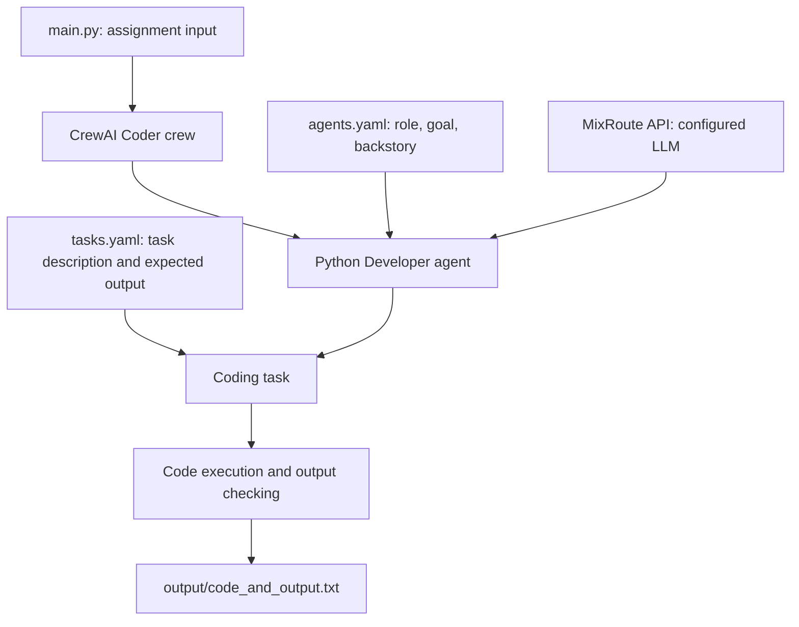

# CrewAI Coder

A beginner-friendly CrewAI project that demonstrates how a single AI agent can plan, write, execute, and check Python code for a programming assignment.

This project was built as a learning exercise to explore CrewAI's coding capabilities, agent configuration, task definitions, and code execution.

## What it does

The project gives a Python programming assignment to a CrewAI agent configured as a Python Developer. The agent is instructed to plan an approach, write code, run it, and check the output.

The current assignment asks the agent to approximate \(\pi\) using the first 10,000 terms of the Leibniz series:

\[
\pi \approx 4 \sum_{i=0}^{9999} \frac{(-1)^i}{2i+1}
\]

The result is written to `output/code_and_output.txt`.

## Architecture



### Execution flow

1. `main.py` defines the programming assignment and passes it to the crew.
2. `crew.py` configures the LLM through MixRoute and creates the agent and crew.
3. `config/agents.yaml` describes the agent's role, goal, and backstory.
4. `config/tasks.yaml` describes the coding task and specifies the output file.
5. The agent is allowed to execute code in CrewAI's `safe` code-execution mode, with a 30-second execution limit and up to five retries.
6. The task output is saved to `output/code_and_output.txt`, and the raw result is printed to the terminal.

## Tech stack

- **Python** — application language
- **CrewAI** — agent and task orchestration
- **MixRoute** — OpenAI-compatible model API endpoint used by CrewAI's `LLM` interface
- **LLM model configured in the code:** `gemini-3.5-flash-lite`
- **Alternative model initialized in code:** `deepseek-v4-flash` (currently assigned to `llm1`, which is not used by the agent)
- **uv** — dependency and environment management
- **YAML** — agent and task configuration

The project dependency is pinned to `crewai[tools]==1.14.4` in `pyproject.toml`.

## Prerequisites

- Python `>=3.10,<3.14`
- [`uv`](https://docs.astral.sh/uv/)
- A MixRoute API key with access to the configured model

## Setup

### 1. Clone the repository

```bash
git clone <your-repository-url>
cd crewai-coder
```

Replace `<your-repository-url>` with the URL of your GitHub repository.

### 2. Install dependencies

From the project root, run:

```bash
uv sync
```

### 3. Configure the API key

Create a `.env` file in the project root:

```env
MIXROUTE_API_KEY=your_mixroute_api_key
```

Do not commit `.env` or publish your API key. Make sure `.env` is included in `.gitignore`.

## Run the project

From the repository root, run:

```bash
uv run run_crew
```

The project entry point is `coder.main:run`, as defined in `pyproject.toml`. The assignment is currently hard-coded in `src/coder/main.py`. Edit the `assignment` variable there to try a different programming task.

The crew's LLM configuration is in `src/coder/crew.py`. The active agent uses `gemini-3.5-flash-lite` through `https://api.mixroute.ai/v1`.

## Example result

The checked-in output file contains a generated solution for the Leibniz-series assignment. Its recorded result is:

```text
Result after multiplying the first 10000 terms by 4: 3.1414926535900345
```

This is an example captured in `output/code_and_output.txt`; results may vary between model runs.

## Configuration guide

| File | Purpose |
|---|---|
| `src/coder/main.py` | Defines the assignment and starts the crew |
| `src/coder/crew.py` | Configures the MixRoute LLM, agent, task, and sequential crew |
| `src/coder/config/agents.yaml` | Defines the agent's role, goal, and backstory |
| `src/coder/config/tasks.yaml` | Defines the task and output destination |
| `pyproject.toml` | Declares project dependencies and command-line entry points |

## Learning points

This project is a small example of:

- Defining an agent with a role, goal, and backstory.
- Separating agent configuration from Python code using YAML.
- Defining a task with an expected output and an output file.
- Connecting CrewAI to a model API through a base URL and API key.
- Enabling agent code execution and setting execution/retry limits.
- Running a crew from a project entry point.


